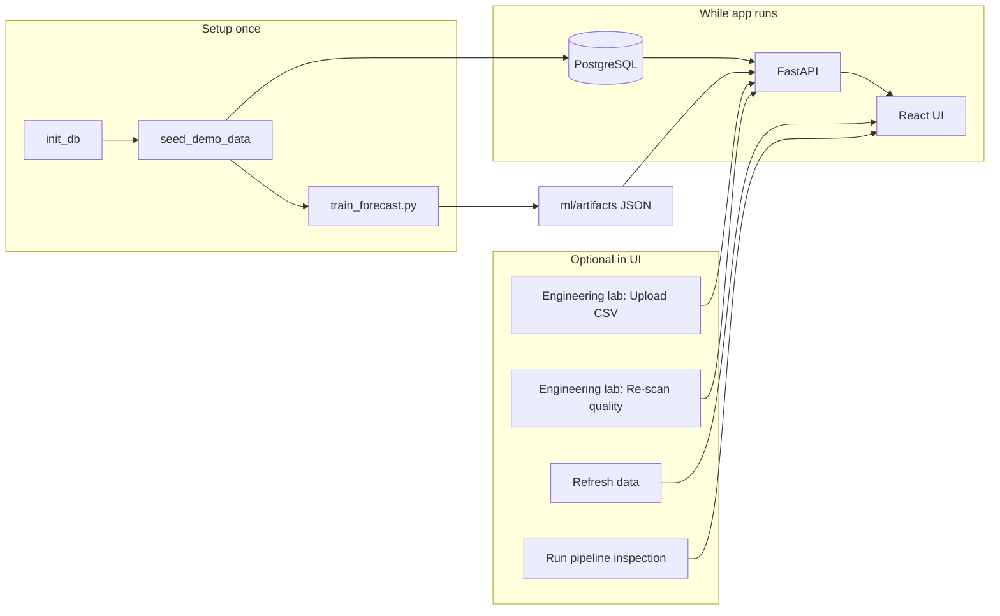

# Demo flow (learn & verify without screen recording)

Use this when you are still building confidence. No GIF or video required.

## One-time setup (terminal)

```bash
cd backend
PYTHONPATH=. python3 scripts/init_db.py
PYTHONPATH=. python3 scripts/seed_demo_data.py
PYTHONPATH=. python3 ../ml/train_forecast.py
PYTHONPATH=. uvicorn app.main:app --reload --port 8000
```

Second terminal:

```bash
cd frontend && npm run dev
```

Open http://127.0.0.1:5173

## Flow diagram (what happens in order)



## Operator surface (default on load)

| Area | What you see |
|------|----------------|
| Overview | **Refresh data** only — loads summary, quality, deviations, chart |
| Telemetry / Forecast cards | Counts and test metrics |
| Quality + deviation panels | Stored events and day narratives |
| Chart | Held-out actual vs predicted |

Pipeline inspection does **not** run until you click **Run inspection** at the bottom.

## Actions to practice (in order)

| Step | You do | What should change |
|------|--------|-------------------|
| 1 | Open app | Panels load; no inspection table until you run it |
| 2 | Read **Telemetry** card | `reading_count` ≈ 334 after seed; sources banner lists `SYNTHETIC_DEMO` |
| 3 | Expand **Engineering lab** → **Re-scan quality** | Info notice; quality events panel updates |
| 4 | **Upload CSV** → `data/raw/example_plant_export.csv` | Message with rows inserted; summary shows `MEASURED_CSV` |
| 5 | Upload the **same CSV again** | `0` new rows, message about skipped duplicate timestamps |
| 6 | **Refresh data** | Panels update |
| 7 | (Terminal) run `train_forecast.py` again | Forecast metrics update on next refresh |
| 8 | **Run inspection** | PASS/WARN/FAIL table for API smoke checks |
| 9 | DevTools → Network | JSON matches on-screen numbers |

Training stays in the terminal on purpose—you can say: *“ML is offline; the UI only serves artifacts.”*

## Optional screenshot (for portfolio later)

When ready, take **one** PNG of the operator view (summary + chart) and save as:

`docs/screenshots/dashboard.png`

## If inspection shows warnings

| Warning | Fix |
|---------|-----|
| No telemetry | Run `seed_demo_data.py` or upload CSV once |
| Forecast / deviation | Run `../ml/train_forecast.py`, then refresh |
| API offline | Start uvicorn on port 8000 |
